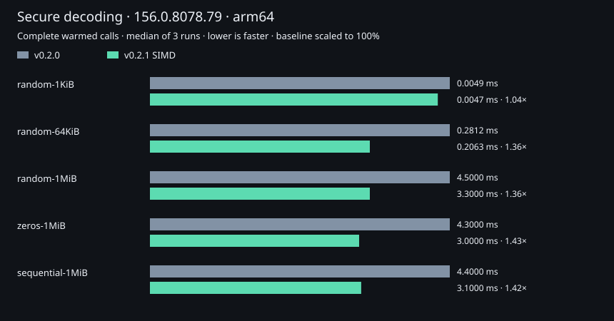

# Public decoder measurements

These results contain only deterministic public fixtures. The local paired run
uses Chromium 156.0.8078.79 / V8 15.6.75.27 on ARM64. Complete `binary()` calls
compare the v0.2.0 implementation with SIMD BLAKE3, preserving the exact module
hashes in [environment.json](environment.json).

- [Compact CSV](compact.csv): default secure calls for five public fixtures.
- [All settings](all-settings.csv): twelve runtime combinations and run ranges.
- [Independent x64 comparison](github-x64/compact.csv): seven public fixtures on
  Chromium 153.0.8010.12 / Xeon Platinum 8370C; [environment](github-x64/environment.json).
- [Fresh peer comparison](peers/summary.md), [compact CSV](peers/compact.csv),
  [all settings](peers/summary.csv), [chart](peers/decode.svg), and
  [environment](peers/environment.json).

Each paired campaign uses three fresh browsers, three warm-ups and nine measured
alternating batches per setting. Both implementations share a batch calibrated
to at least 2 ms, capped at 4,096 calls. Values are medians of run medians; min/max
run medians describe between-run spread, not individual-call tail latency.

Included: resident strings, fresh owned outputs, verification and the JS/Wasm
bridge. Excluded: input generation, imports, initialization and byte comparisons.
Heavy lookup tables are warm. Hosts are unpinned; observations are not universal
speed guarantees. Separate campaigns must not be combined into one timing claim.

Regenerate paired CSV/SVG reports with the Rust `paired_report` example. Generate
a fresh transport comparison with `glyphpack bench run` and `glyphpack summary`.
