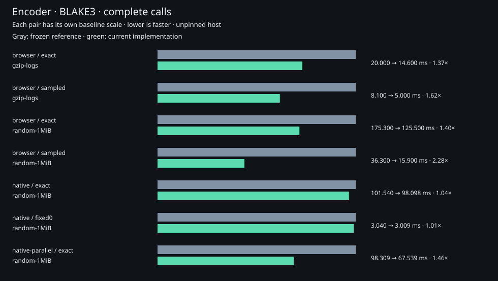

# Encoder measurements

Complete encoding calls against the frozen v0.2.1 encoder, using deterministic
public fixtures. Encoded output is compared byte for byte before timing.

- [Compact CSV](compact.csv): selected BLAKE3 cases.
- [All settings](all-settings.csv): all three integrity modes, native output
  representations, mask policies, and between-run ranges.
- [Environment and source hashes](environment.json).
- [Independent GitHub x64 campaign](github-x64/summary.md),
  [all settings](github-x64/all-settings.csv), and
  [environment](github-x64/environment.json).

Local measurements use Chromium 156.0.8078.79 on an eight-logical-CPU ARM64 Linux
host reporting Cortex-A720 and Cortex-X4 cores. The exact core, frequency,
temperature and affinity are uncontrolled. Native code uses Rust 1.99.1 without
additional RUSTFLAGS. The separate GitHub campaign uses Chromium 153.0.8010.12
on an AMD EPYC 9V45 x64 runner. Do not combine their absolute timings.

Browser results have three fresh processes, three warm-ups, and nine alternating
measured batches per setting. Each shared batch is calibrated to at least 2 ms
for both implementations, capped at 2,048 calls. Native results have three fresh
processes per configuration and nine alternating individual calls after three
warm-ups. Summaries use the median of process medians; ranges describe process
medians, not individual-call tail latency. The GitHub native subset has one
process per configuration and is labeled accordingly.
Empty native calls can fall below clock resolution; their raw samples are
retained, but all empty native cases are omitted from timing summaries.

Timers include hashing, mask selection, packing and output construction. Browser
calls also include the input copy and consumption of a character from each
result, which can materialize the legacy concatenated string. Inputs and output
capacity are warm in the browser; native calls create fresh owned outputs.
Imports, fixture loading, correctness checks and output hashing are excluded.
Native output drops are outside timing.
Reported Wasm linear memory is the retained memory after a call, not peak total
memory across JavaScript and Wasm.

`native-parallel` is an opt-in Cargo feature, capped at four workers; it is a
separate configuration, not the default native implementation. Many inputs
still take its serial path. Output bytes, mask priorities and ties are identical.

The release's encoder-samples archive retains raw samples, input fingerprints,
module fingerprints, the tested browser modules/host, fixture-generation
instructions and notices. The fixtures themselves are reproducible with
`encoder_compare --prepare`; no other project's files are required. See
[methodology and commands](../../../docs/benchmarking.md).
